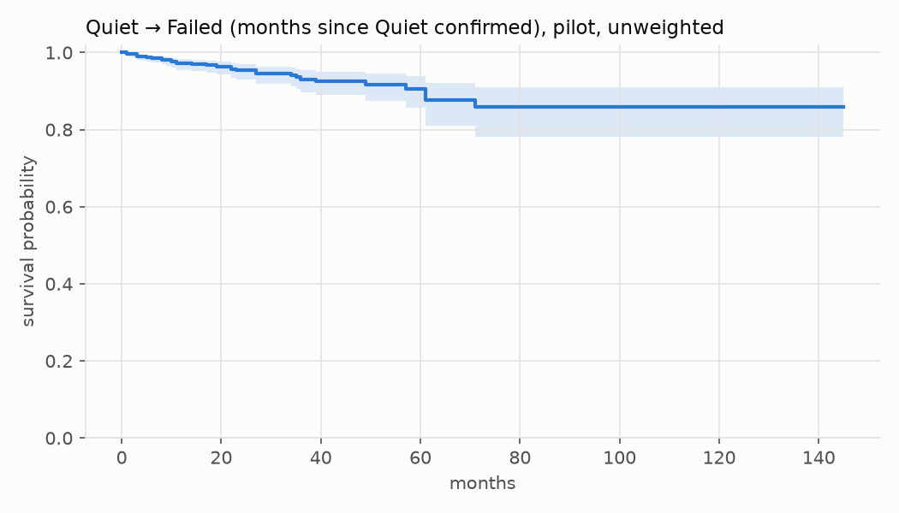
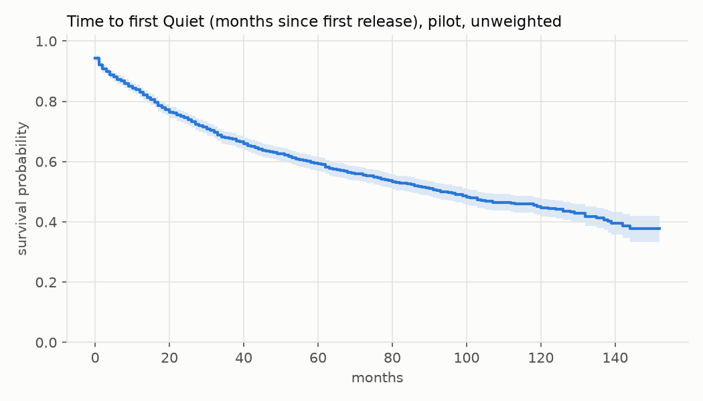

# Gate 1 report — Phase 0 pilot

Generated 2026-10-26 07:39 UTC by `pipeline report` from pipeline outputs only. deps.dev snapshot 2026-10-19T21:00:03.578565+00:00; data freeze 2025-09-30; quiet window 12 months.

## Verdict: **viable** (provisional — pending the 100-package hand check)

- projected failures 4,426 ≥ 1,000
- Quiet→Failed KM fell 0.018 between month 64 and 96 after confirmation (≥20 at risk) — descriptive only; formal test in Phase 1
- The hand check (`reports/gate1_handcheck.csv`) has not been scored yet; Gate 1 also requires the bot filter and state machine to pass it.

## Pilot and pulls

- Universe (≥1 direct dependent, GitHub repo, first upload 2012-01-01–2022-12-31): 46,267 packages; eligible after repo resolution: 42,046.
- Pilot selected: 2,000 (1,000 top, 1,000 tail).
- Pulled successfully (PyPI + git, in the analysis): **1,996**; not analysed: 4 (0.2%).
- Packages sharing a repo with another pilot package (monorepo flag): 216.

| step | reason | packages |
|---|---|---:|
| pypi_roles | Fault: <Fault -32500: 'HTTPTooManyRequests: The action could not be performed because ther | 19 |
| git | CloneFailed: fatal: destination path 'C:\Users\aryan\Desktop\prob\data\git\click-contrib__ | 2 |

## Transitions

- Quiet transitions: 1,395 across 904 packages.
- Revivals: 791 across 559 packages.
- Failed (first dated trigger): **184** packages.
- Packages with maintainer activity after their failure date: 113 (activity is ignored after failure).

| failure trigger | from state | packages |
|---|---|---:|
| advisory | ACTIVE | 20 |
| advisory | REVIVED | 2 |
| archived | ACTIVE | 31 |
| archived | QUIET | 39 |
| archived | REVIVED | 7 |
| python_support | ACTIVE | 70 |
| python_support | QUIET | 10 |
| python_support | REVIVED | 5 |

All trigger firings (a package can fire several; undated ones cannot be placed on the timeline):

| trigger | fired | undated |
|---|---:|---:|
| advisory | 24 | 0 |
| archived | 89 | 6 |
| python_support | 88 | 0 |

- Trigger (d), explicit statements, is not implemented in Phase 0.

When each transition becomes knowable (by `observable_month`, splits from config):

| transition to | period | count |
|---|---|---:|
| FAILED | calibration | 25 |
| FAILED | test | 82 |
| FAILED | train | 77 |
| QUIET | calibration | 206 |
| QUIET | test | 564 |
| QUIET | train | 625 |
| REVIVED | calibration | 107 |
| REVIVED | test | 332 |
| REVIVED | train | 352 |

## Classifier signals

- `7 - Inactive`: 26 packages; of these 7 failed and 9 went Quiet. Of 184 failed packages, 7 carry Inactive.
- `6 - Mature` (validation only): 31 packages; 5 failed, 11 went Quiet.

## Kaplan–Meier curves (pilot, unweighted)

### Quiet → Failed, from Quiet confirmation

n = 904, events = 35, max follow-up = 145 months, median = n/a months.

| month | S(t) | at risk |
|---:|---:|---:|
| 12 | 0.972 | 440 |
| 24 | 0.954 | 271 |
| 36 | 0.931 | 182 |
| 60 | 0.905 | 66 |
| 96 | 0.859 | 20 |

### Time to first Quiet, from first release

n = 1,996, events = 904, max follow-up = 152 months, median = 94.0 months.

| month | S(t) | at risk |
|---:|---:|---:|
| 12 | 0.830 | 1,651 |
| 24 | 0.745 | 1,417 |
| 36 | 0.677 | 1,171 |
| 60 | 0.593 | 797 |
| 96 | 0.495 | 389 |

Note: Quiet → Failed time is measured from Quiet *confirmation* (last activity + W). Failures inside the W-month window are, by the state-machine rule, Active → Failed, so measuring from the last activity would put a structural zero in the first W months.

## Projection to the eligible universe

- Projected failed packages: **4,426** (95% interval 3,650–5,201, SE 396) over a design-weighted universe of 42,046 packages.
- Assumptions: stratified Horvitz–Thompson estimator with the pilot's selection weights; non-responding packages resemble responders in their stratum; the eligible universe is today's (selection on current dependents, a survivor bias logged in DECISIONS.md); the failure definition is Phase 0's (triggers a–c only, undated triggers excluded). Strata with a single responder contribute no variance (2).

## Cost

- BigQuery: 10 queries run, 22.487 GB billed in phase0; 28 dry-runs (free).
- API calls (network only; cache hits excluded): api.github.com: 859, play.clickhouse.com: 94.
